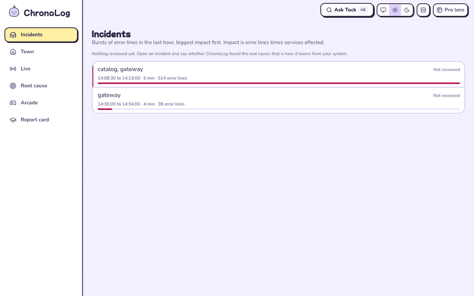
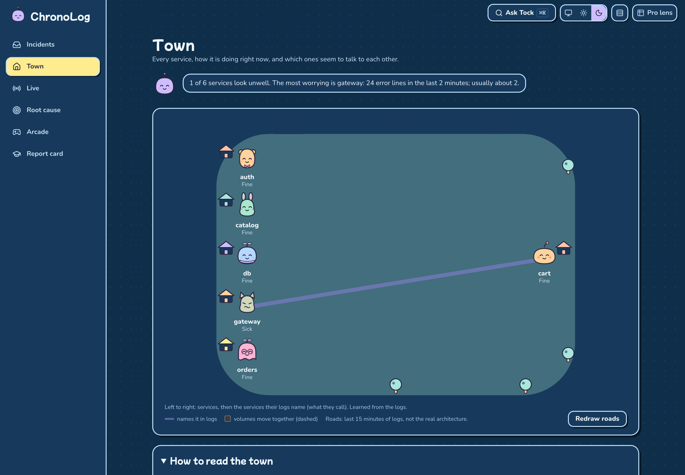
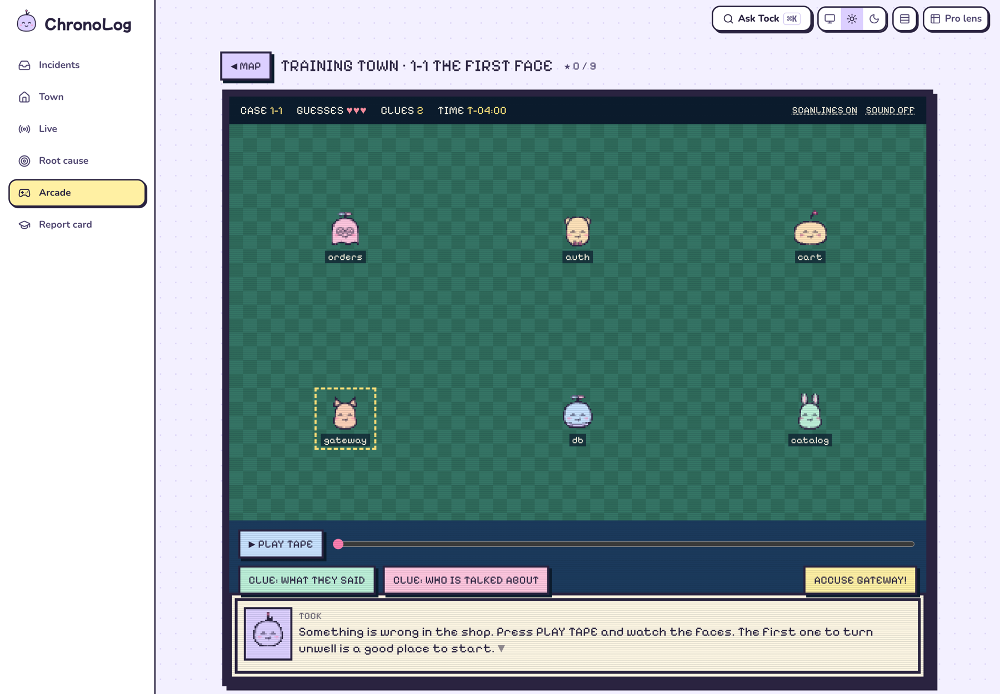
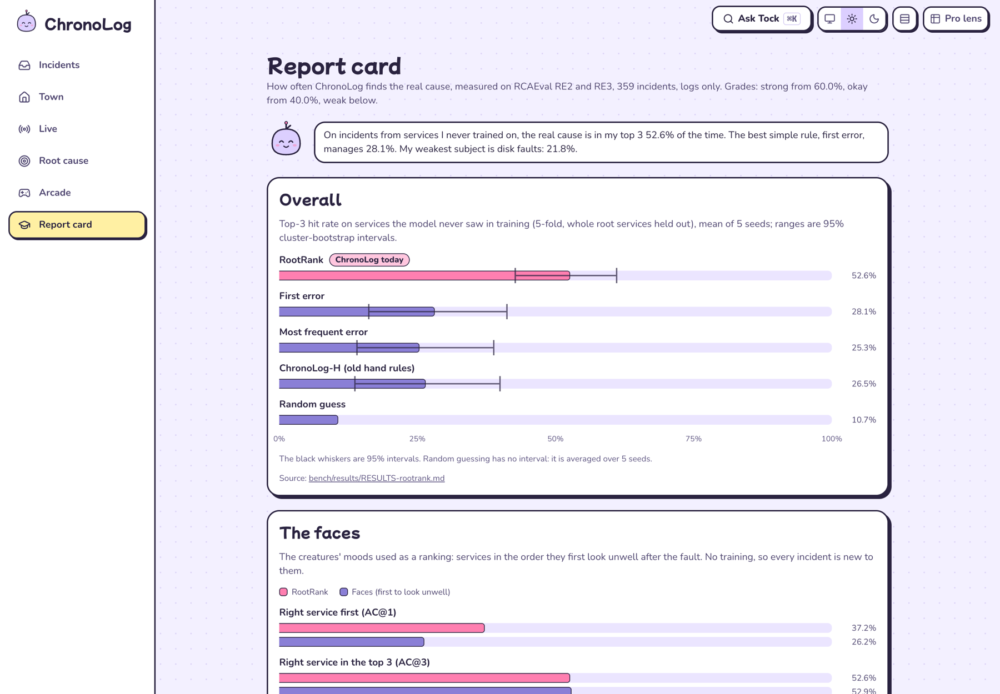
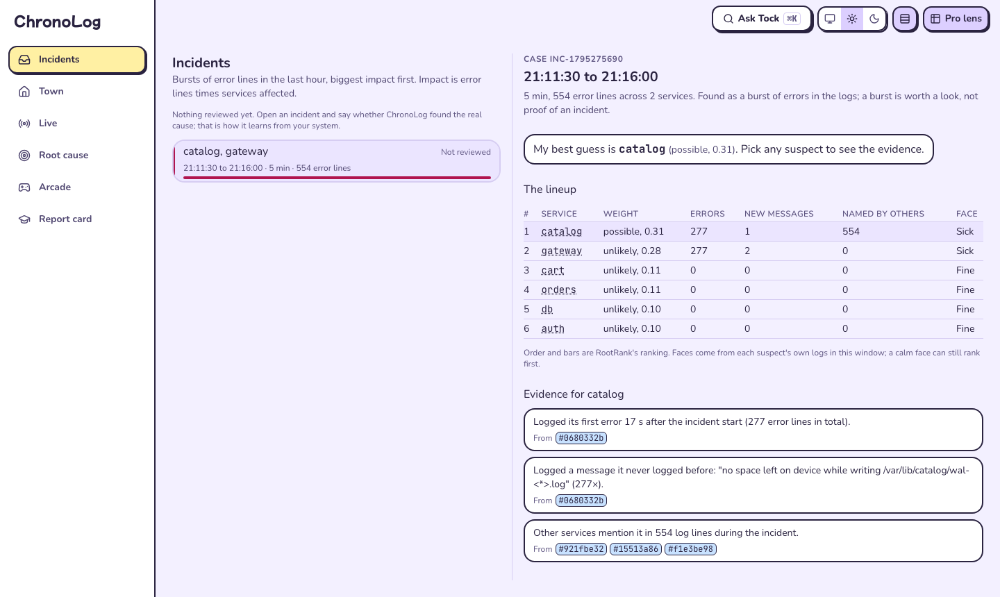
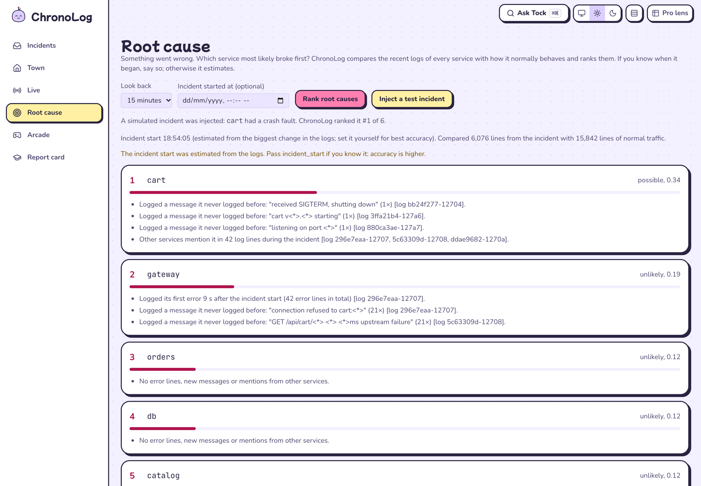
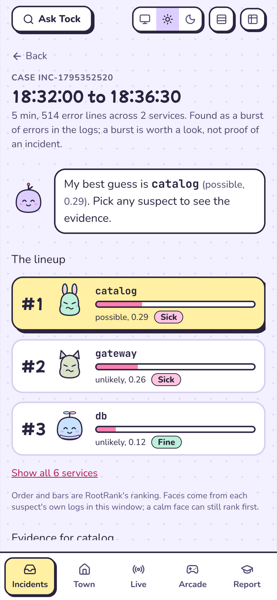
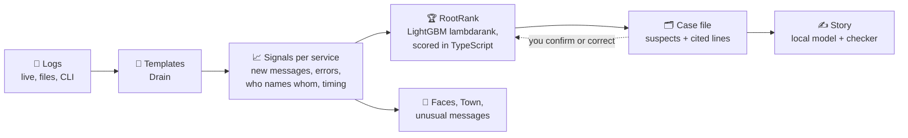

<h1 align="center">ChronoLog</h1>

<p align="center">
  <b>Something broke. Which service broke first?</b><br/>
  An open root-cause engine for logs that shows its evidence and publishes its own report card.
</p>

<p align="center">
  <a href="https://chronolog.akchhya.xyz/"><b>▶ Try it in your browser</b></a> ·
  <a href="#the-report-card">How often it's right</a> ·
  <a href="#run-it-on-your-own-logs">Run it on your logs</a> ·
  <a href="#reproduce-every-number">Reproduce every number</a>
</p>

<p align="center">
  <a href="https://github.com/azzs11/chronolog/actions/workflows/ci.yml"></a>
  <a href="LICENSE"></a>
  
  
</p>

<p align="center">
  
  <br/><sub>The live demo: a simulated six-service shop, running entirely in your browser.</sub>
</p>

---

## 03:12, a pager goes off

The checkout page is throwing errors. Every service is logging at once, and everyone has a theory.

ChronoLog treats it as a **case**. Every service is a suspect, drawn as a small creature whose face comes from its
own logs. A learned ranker, **RootRank**, puts the suspects in a lineup. Tock, the clockwork detective, reads out the
evidence for each one, and **every sentence points at the log lines it came from**:

> **catalog** · possible, 0.27 · *Sick*
> 💬 Logged its first error 24 s after the incident start (257 error lines in total). `#c346ff48`
> 💬 Logged a message it never logged before: "no space left on device while writing /var/lib/catalog/wal-<*>.log"

You close the case by confirming or correcting the answer. ChronoLog stores that answer next to the features the
model saw, so it can be retrained on *your* system.

<p align="center">
  
</p>

---

## The report card

Most tools in this space show you a number. ChronoLog shows how it got the number, and the subjects it fails.

**Root cause, on 359 real incidents** from [RCAEval](https://github.com/phamquiluan/RCAEval) (RE2 and RE3, logs
only), scored on services the model never saw in training. *AC@k* = the real culprit is in the top *k*.

| Method | AC@1 | AC@3 | 95% interval (AC@3) |
|---|---|---|---|
| 🎲 Random guessing | 2.4% | 10.7% | ± 4.8 over 5 seeds |
| 🚨 First service to log an error | 7.2% | 28.1% | 16–41% |
| 📜 ChronoLog-H, the old hand-written rules | 7.8% | 26.5% | 14–40% |
| 🙂 The creatures' faces (no training) | 26.2% | 52.9% | 41–64% |
| 🏆 **RootRank**, a learned ranker | **37.2%** | **52.6%** | 43–61% |

RootRank beats the first-error rule by 24.5 points of AC@3 on the same incidents (paired interval +10.6 to +36.6).

**The grades it would rather hide:**

| Subject | Grade | What happened |
|---|---|---|
| Code faults (90 cases) | 💯 100% AC@3 | Too easy, and the reason is measured: those faults were injected by **restarting** the service, which then logs startup lines it never logged before (81 of 90 cases). |
| Resource faults: CPU, memory, disk, network (269 cases) | 😬 **36.8%** AC@3 | The honest headline. First-error gets 20.8%. Two extra feature families failed to lift it. |
| Spotting anomalies on Loghub BGL | 📉 F1 22–27% | The new template-based detectors beat the old rules (15.9%) but **lose to a plain "flag error lines" rule (30.8%)**. The app shows unusual messages as clues, never as alerts. |
| Spotting anomalies on Loghub HDFS | 📉 F1 11.4% | Barely beats flagging everything (10.7%). |
| Guessing when the incident began | ⚠️ 53.2% → 45.0% | AC@3 drops by 8 points when ChronoLog has to estimate the start instead of being told. |
| Messy logs: 40% of lines dropped | 💪 −1.3 points | Clock skew of ±2 s costs 0.4. |
| AI-written summaries (below) | ✍️ 89.2% citation precision | 30 simulated incidents, local model, a checker on every sentence. |

<sub>Every number above is generated from `bench/results` and links to the script that made it:
[rootrank](bench/results/RESULTS-rootrank.md) · [ablation](bench/results/RESULTS-ablation.md) ·
[moods](bench/results/RESULTS-moods.md) · [anomaly v2](bench/results/RESULTS-anomaly-v2.md) ·
[autostart](bench/results/RESULTS-autostart.md) · [robustness](bench/results/RESULTS-robustness.md) ·
[stories](bench/results/RESULTS-stories.md). The same numbers appear in the app's Report card, and a test
fails if the two ever disagree.</sub>

---

## Write it up, without making things up

Ask for a **case summary** and a small *local* model (`qwen2.5:3b` through [Ollama](https://ollama.com), free,
nothing leaves your machine) writes it. The model never sees raw logs. It gets numbered facts (`E1`, `E2`, …) that
the engine already computed, and it must cite them. Then a checker reads **every sentence** and throws out any that:

| Drops a sentence that… | Example |
|---|---|
| gives a reason the facts don't state | *"…was shutting down **due to** receiving SIGTERM"* (from the benchmark) |
| names no suspect at all | *"Other services mentioned **the issue** in 596 log lines"* (from the benchmark) |
| cites a fact about a different service | a sentence about `gateway` citing a fact about `cart` |
| uses a number that isn't in its facts | *"catalog logged **500** errors"* when the facts say 257 |
| cites nothing, or a fact that doesn't exist | — |

What survives is shown with the real log ids behind it. **Nothing uncited ever reaches the screen.** On 30
simulated incidents the checker kept 90.6% of sentences, with 89.2% citation precision and a median of under 3 s
per summary ([RESULTS-stories.md](bench/results/RESULTS-stories.md)). The checks are mechanical, so a kept sentence
can still overstate a fact, and the report says so. Stories are **off by default**; the app does everything else
without a model.

```bash
ollama pull qwen2.5:3b
STORY_PROVIDER=ollama docker compose up -d     # then "Write it up" appears in each case file
```

---

## Let your AI agent investigate, with receipts

`apps/mcp` is a [Model Context Protocol](https://modelcontextprotocol.io) server, so Claude, Cursor or any MCP
client can debug through ChronoLog instead of guessing:

| Tool | Returns |
|---|---|
| `list_incidents` | Recent bursts of errors, biggest impact first |
| `explain_incident` | The ranked suspects, every evidence line tagged `[log <id>]` |
| `search_logs` | Matching log lines, each with its id |

```json
{ "mcpServers": { "chronolog": {
    "command": "node", "args": ["apps/mcp/dist/server.js"],
    "env": { "CHRONOLOG_API_URL": "http://localhost:5050" } } } }
```

---

## A tour of the town

<table>
  <tr>
    <td width="50%"></td>
    <td width="50%"></td>
  </tr>
  <tr>
    <td><b>🏘️ Town.</b> Every service and its mood (fine, new phrase, stressed, sick, gone quiet, restarted), each with
    a written reason and log ids. Roads are learned from which services name each other. Faces are
    <i>symptoms</i>: a slow database can look fine while its callers look sick.</td>
    <td><b>🕹️ Arcade.</b> ChronoLog's training mode, in 16-bit. Three short cases teach you to read the app, then a
    Daily Case with a Wordle-style share, 30 real incidents, a sandbox, and drills built from your own reviewed
    incidents.</td>
  </tr>
  <tr>
    <td></td>
    <td></td>
  </tr>
  <tr>
    <td><b>📓 Field notes.</b> Every case ends with what gave it away, how Tock did (it misses too), and what this
    fault looks like in production.</td>
    <td><b>🎓 Report card.</b> The benchmark as charts inside the app, weak grades included.</td>
  </tr>
  <tr>
    <td></td>
    <td></td>
  </tr>
  <tr>
    <td><b>🤓 Pro lens</b> (Shift+P). Not into creatures? The same data as dense, keyboard-first tables.</td>
    <td><b>📡 Live.</b> Incoming logs grouped by template, plus <i>unusual messages</i>: ones that were rare or absent
    in the hour before, each citing its lines.</td>
  </tr>
  <tr>
    <td></td>
    <td align="center"></td>
  </tr>
  <tr>
    <td><b>🎯 Root cause.</b> Rank any window, drop your own log files (analysed in the browser, nothing uploaded),
    or inject a fault with a known cause and watch where ChronoLog puts it. Misses are shown like hits.</td>
    <td><b>📱 On a phone.</b> Every view works at phone width. The demo scores 100 on Lighthouse accessibility.</td>
  </tr>
</table>

---

## How it thinks



1. **Templates.** [Drain](https://github.com/logpai/Drain3) turns `user 42 logged in` and `user 7 logged in` into one
   template. The TypeScript port matches the Python original exactly on real incidents (a parity test).
2. **Signals.** For each service: messages it never logged before, error counts and spikes, how often others name
   it, and when each started. One signal does most of the work: *messages it never logged before*.
3. **RootRank.** LightGBM learning-to-rank, trained offline on the benchmark and exported as JSON trees. One pure
   TypeScript engine scores it in the server, the browser and the CLI.
4. **Case file and story.** Every evidence sentence is built from engine fields, cites log ids, and optionally gets
   retold by a local model under the checker.

The original rule engine, **ChronoLog-H**, still runs as the named baseline it has to beat.

| Part | Built with |
|---|---|
| `packages/engine` | TypeScript, pure (no I/O): ranking, templates, moods, anomaly, story checker, simulator |
| `apps/web` | React 19, Vite, Tailwind 4 |
| `apps/api` | Node.js 22, Express, Socket.io, PostgreSQL 15 |
| `apps/cli` · `apps/mcp` | `chronolog analyze` for files · MCP server for agents |
| `bench/` | Python 3.12, uv, LightGBM, pandas |

**How it differs.** Automated root-cause analysis isn't new: [Datadog Watchdog RCA](https://docs.datadoghq.com/watchdog/)
has been generally available since 2021, and Bits AI SRE investigates alerts on its own. ChronoLog is **open**
(engine, model and benchmark are MIT and readable), **explainable** (every claim cites lines), **benchmarked**
(failures published next to wins) and **self-hosted** (no log data leaves your machine).

---

## Run it on your own logs

```bash
git clone https://github.com/azzs11/chronolog.git && cd chronolog
cp .env.example .env          # set your own passwords, including GRAFANA_PASSWORD
docker compose up -d          # 4 containers, about 1.1 GB of memory at most
```

Open the app on **port 3000**. Want a case right away? Break something on purpose (set `API` to the API's address;
it listens on port 5050 by default):

```bash
curl -X POST "$API/api/rca/incident" -H 'Content-Type: application/json' \
  -H 'X-API-Key: dev_key_change_in_prod' -d '{"service":"catalog","fault":"disk"}'
```

Then open **Incidents**. Send real logs with `POST /api/logs`.

**Just files?** One file per service, plain text with a timestamp at the start of each line, or JSON lines:

```bash
npm ci && npm run build
node apps/cli/dist/cli.js analyze logs/api.log logs/db.log logs/cache.log --start 2026-11-19T10:02:00Z
```

Leave out `--start` and ChronoLog estimates when the incident began (less accurate, see the report card).

<details>
<summary><b>Ports, settings and the static demo</b></summary>

| Service | Host port |
|---|---|
| App | 3000 |
| API | 5050 (`BACKEND_PORT`) |
| ML service | 5001 |
| Grafana, Prometheus (`docker compose --profile monitoring up -d`) | 3001, 9090 |

| Variable | Default | Description |
|---|---|---|
| `POSTGRES_PASSWORD` | `debug_secret` | PostgreSQL password |
| `ADMIN_API_KEY` | `dev_key_change_in_prod` | Key for admin endpoints |
| `GRAFANA_PASSWORD` | none (required) | Grafana admin password |
| `BACKEND_PORT` | `5050` | Host port for the API in Docker |
| `STORY_PROVIDER` | `off` | `ollama` turns on case summaries |
| `OLLAMA_URL`, `OLLAMA_MODEL` | host Ollama, `qwen2.5:3b` | The summary model (only this one is measured) |

The demo is a static site with an in-browser simulated backend: `npm run build:demo -w chronolog-web` writes
`apps/web/dist-demo` (hosting: [docs/DEPLOY.md](docs/DEPLOY.md)).
</details>

---

## Reproduce every number

```bash
cd bench                                # needs uv: https://docs.astral.sh/uv/
uv run bench download --subset full     # RCAEval logs (about 400 MB)
uv run bench all --subset full          # baselines + ChronoLog-H, ~45 min   -> RESULTS-full.md
uv run bench templates --subset full    # Drain templates, cached (~8 min)
uv run bench rootrank                   # RootRank, 5 seeds                  -> RESULTS-rootrank.md
uv run bench ablate                     # what each signal is worth          -> RESULTS-ablation.md
uv run bench moods                      # the faces as a ranking             -> RESULTS-moods.md
uv run bench robustness                 # dropped lines, gaps, clock skew    -> RESULTS-robustness.md
uv run bench anomaly-v2                 # Loghub HDFS + BGL, ~70 s           -> RESULTS-anomaly-v2.md
uv run bench stories                    # needs Ollama, ~6 min               -> RESULTS-stories.md
uv run bench export-facts               # regenerates the numbers the app shows
```

The rules: splits are fixed by case id before any tuning and the test list is looked at once; intervals resample
whole (system, root service) groups, because instances of one fault are near-copies; every run is byte-for-byte
repeatable except the story benchmark, where a local model varies slightly and three runs are averaged; settings
seen while developing (like the story checker's dev seeds) are kept apart from the ones reported.

<details>
<summary><b>More findings, and the limits</b></summary>

- **The faces** need no training and tie RootRank at AC@3 (−0.3 points, −6.7 to +6.3) but trail at AC@1 (26.2% vs
  37.2%). The broken service looks unwell within 5 minutes in 48% of incidents; 4% of services look unwell before
  anything broke.
- **The service map can be learned from logs, unevenly:** "A's logs name B" has 93% edge precision on Sock Shop and
  2% on Online Boutique, whose logs never name other services ([RESULTS-graph.md](bench/results/RESULTS-graph.md)).
- **The old engine's score hurts RootRank** when added as a feature (49.1% vs 52.6% AC@3).
- In 26 of the 359 incidents the faulty service writes no logs at all. No log-based method can name it.
- **Logs only:** no metrics or traces, so faults that barely touch the logs (CPU, slow networks) are the hardest.
- **The inbox lists bursts of errors.** Warning-only faults (memory pressure, slow networks) show up in Town and
  Root cause instead.
- **Confidence words aren't calibrated:** "possible, 0.27" is a relative weight, not a probability.
- **The simulator is easier than real life.** Training, Daily and Sandbox cases are simulated; Real Systems cases
  are real. The story benchmark uses simulated incidents because real RCAEval lines carry no ids.
- **Single instance:** fine for a team's logs, not built for a fleet.
</details>

<details>
<summary><b>API reference</b></summary>

All endpoints return `{ status, data }`. In Docker the API is on port 5050; `npm run dev` uses 5000.

| Method | Path | Description |
|---|---|---|
| `GET` | `/health` | Health check |
| `GET` | `/api/logs` | Recent logs (`?limit=50&severity=error&source=db&search=disk`) |
| `POST` | `/api/logs` | Ingest a log line |
| `GET` | `/api/logs/stats` | Severity counts and throughput |
| `POST` | `/api/logs/generator/start` | Start sample traffic (admin key) |
| `GET` | `/api/incidents` | Bursts of error lines, biggest impact first, with review status |
| `GET` | `/api/incidents/:id` | One incident: ranking, evidence, per-service timeline, learned service graph |
| `POST` | `/api/incidents/:id/feedback` | "Was this the root cause?" `{ verdict: confirm \| reject, correct_service?, note? }` |
| `GET` | `/api/incidents/feedback/summary` | How often the first choice was right on the incidents you reviewed |
| `GET` | `/api/incidents/story/status` | Is a summary model configured? |
| `POST` | `/api/incidents/:id/story` | A checked, cited summary (`503 story_off` when no model) |
| `POST` | `/api/rca/rank` | Rank any window, or logs you send |
| `GET` | `/api/rca/graph` | The service graph learned from recent logs |
| `POST` | `/api/rca/incident` | Inject a simulated incident with a known cause (admin key) |
| `GET` | `/api/moods` | Each service's mood right now, with a reason and log ids |
| `GET` | `/api/anomalies/unusual` | Messages rare or new in the last 5 min versus the hour before, with log ids |
| `GET` | `/api/anomalies` | The old engine's anomalies |
| `GET` | `/api/causal/chains` | ChronoLog-H's causal chains (the old engine) |
| `GET` | `/metrics` | Prometheus metrics |

`POST /api/rca/rank` takes, all optional: `incident_start` (Unix seconds or ISO time; estimated if left out),
`lookback_minutes` (1 to 120, default 15), or `logs` (up to 20,000 lines `{ timestamp, source, message, severity?, id? }`).
It answers `422` if the logs span under 4 minutes or there are none.

```bash
curl -X POST "$API/api/rca/rank" -H 'Content-Type: application/json' -d '{"lookback_minutes": 15}'
```

WebSocket events (server to client): `new-log`, `log-stats`, `causal-event`, `connection-success`.
</details>

<details>
<summary><b>Development</b></summary>

```bash
npm ci                                   # at the repo root (npm workspaces)
npm run build                            # engine, API, web, CLI, MCP server, bench runner
npm run dev -w chronolog-backend         # API on :5000
npm run dev -w chronolog-web             # web on :3000 (set VITE_API_URL if the API is elsewhere)
npm test && npm run lint && npm run typecheck
(cd bench && uv run pytest && uv run ruff check . && uv run ruff format --check .)
```

See [CONTRIBUTING.md](CONTRIBUTING.md).
</details>

---

## Cite it

```bibtex
@software{singh_chronolog_2026,
  author = {Singh, Akchhya},
  title  = {ChronoLog: an open, benchmarked root-cause engine for logs},
  year   = {2026},
  url    = {https://github.com/azzs11/chronolog}
}
```

The benchmark stands on [RCAEval](https://github.com/phamquiluan/RCAEval) (Pham et al., WWW 2025) and
[Loghub](https://github.com/logpai/loghub); please cite them too. [MIT licensed](LICENSE).

<p align="center"><sub>Built by <b>Akchhya Singh</b> · <a href="https://github.com/azzs11">GitHub</a> · <a href="https://linkedin.com/in/akchhya-singh11">LinkedIn</a> · akchhya.dev@gmail.com</sub></p>
