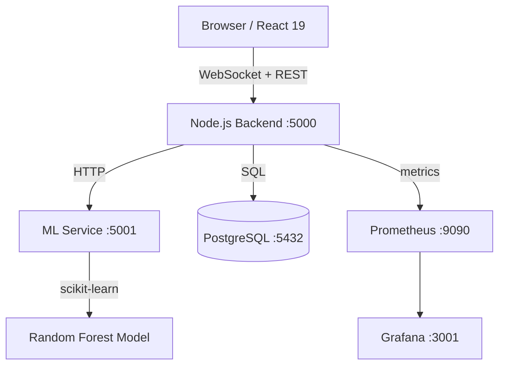

# ◈ ChronoLog

> Real-time log intelligence with causal chain detection

[](https://github.com/azzs11/chronolog/actions/workflows/ci.yml)
[](LICENSE)
[](https://nodejs.org/)
[](https://python.org/)

**ChronoLog** is an open, self-hosted log monitoring system that links log events into
*causal chains*. It shows you what broke, what probably caused it, and how far the damage spread.

> **Status:** ChronoLog 2.0 is in progress. The current engine uses hand-tuned rules and has
> only been tested on synthetic logs. Its root-cause accuracy has not been measured yet; benchmark
> results on public datasets will be published here. See [docs/ROADMAP.md](docs/ROADMAP.md).

---

## How ChronoLog Differs

Automated root-cause analysis is not new. Commercial tools already do it well:
[Datadog Watchdog RCA](https://docs.datadoghq.com/watchdog/)
has been generally available since 2021, and Datadog's Bits AI SRE investigates alerts on its own.
ChronoLog aims to be different in four ways:

- **Open:** the engine, the rules and the data pipeline are all MIT-licensed and readable.
- **Explainable:** every causal link comes with the signals that created it (timing, severity, shared entities, service dependency).
- **Benchmarked (planned):** root-cause accuracy will be measured on public RCA benchmarks, and every number will link to the script that produced it.
- **Self-hosted:** one `docker compose up` on your own machine. No log data leaves it.

---

## Causal Intelligence

When your database goes down, ChronoLog shows you:

```
[CRITICAL] db: connection pool exhausted          ← ROOT CAUSE (blast radius: 14.2)
  └─[ERROR]  api: failed to fetch user data        ← depth 1
      └─[ERROR]  auth: session validation failed   ← depth 2
          └─[WARNING] api: returning 503           ← depth 3

Fix the root node. The downstream symptoms resolve automatically.
```

The causal engine works by correlating log timestamps, source services, and error signatures
within a sliding 30-second window. When a chain is detected, a `causal:chain-detected`
WebSocket event fires within 500ms and the D3 graph updates live.

---

## Architecture



| Layer | Technology |
|-------|-----------|
| Frontend | React 19, Tailwind CSS, D3.js, Socket.io-client |
| Backend | Node.js 18, Express, Socket.io, Winston |
| ML Service | Python 3.10, Flask, scikit-learn |
| Database | PostgreSQL 15 |
| Monitoring | Prometheus, Grafana |
| Infrastructure | Docker, nginx |

---

## ML Model

- **Algorithm**: Random Forest with TF-IDF (n-grams 1–3)
- **Task**: predicts a log's severity level from its message text
- **Training data**: synthetic logs from `apps/ml/src/data_generator.py`
- **Accuracy**: not reported yet. Scores on synthetic data say little about real logs, so
  no number is shown until the model is evaluated on real, labelled datasets.

Real logs usually carry their own level, so the roadmap repurposes this model for logs that
arrive without one.

---

## Quick Start

```bash
git clone https://github.com/azzs11/chronolog.git
cd chronolog
cp .env.example .env   # then set your own passwords, including GRAFANA_PASSWORD
docker compose up -d                        # app only: 4 containers
docker compose --profile monitoring up -d   # also Prometheus + Grafana
docker compose down                         # stop and remove everything
```

Each container has a memory cap (about 1.1 GB for the app, 1.6 GB with monitoring).

Open [http://localhost:3000](http://localhost:3000)

| Service | URL | Credentials |
|---------|-----|-------------|
| App | http://localhost:3000 | — |
| Backend API | http://localhost:5050 (`BACKEND_PORT`) | — |
| ML Service | http://localhost:5001 | — |
| Grafana (monitoring profile) | http://localhost:3001 | `admin` / `GRAFANA_PASSWORD` from `.env` |
| Prometheus (monitoring profile) | http://localhost:9090 | — |

> **First run**: the `ml-service` container trains the model during build (`~30s`).
> Subsequent starts use the cached image and are instant.

---

## Development (without Docker)

### Backend

```bash
cd apps/api
npm install
npm run dev          # nodemon, port 5000
```

### ML Service

```bash
cd apps/ml
python -m venv venv
# Windows:
venv\Scripts\activate
# macOS/Linux:
source venv/bin/activate

pip install -r requirements.txt
python src/train_model.py   # one-time
python src/app.py           # port 5001
```

### Frontend

```bash
cd apps/web
npm install
npm start            # CRA dev server, port 3000
```

Set `REACT_APP_API_URL=http://localhost:5000` and `REACT_APP_WS_URL=http://localhost:5000`
in `apps/web/.env`.

---

## API Reference

All endpoints return `{ status, data, meta }`.

### Backend (`:5000`)

| Method | Path | Description |
|--------|------|-------------|
| `GET` | `/health` | Health check |
| `GET` | `/api/logs` | Paginated log list (`?limit=50&offset=0&severity=error`) |
| `POST` | `/api/logs` | Ingest a log entry |
| `GET` | `/api/logs/stats` | Severity counts + throughput |
| `GET` | `/api/anomalies` | Detected anomalies |
| `GET` | `/api/metrics` | Prometheus metrics |

### ML Service (`:5001`)

| Method | Path | Description |
|--------|------|-------------|
| `GET` | `/health` | Health + model metadata |
| `POST` | `/api/classify` | Classify a single log message |
| `POST` | `/api/classify/batch` | Classify up to 100 messages |

### WebSocket Events

| Event | Direction | Description |
|-------|-----------|-------------|
| `log:new` | server → client | New log entry ingested |
| `log:stats` | server → client | Updated severity counts |
| `causal:chain-detected` | server → client | New causal chain identified |
| `anomaly:detected` | server → client | Temporal anomaly fingerprint |

---

## Environment Variables

Copy `.env.example` to `.env` and change values for production.

| Variable | Default | Description |
|----------|---------|-------------|
| `POSTGRES_PASSWORD` | `debug_secret` | PostgreSQL password |
| `ADMIN_API_KEY` | `dev_key_change_in_prod` | Admin endpoint key |
| `GRAFANA_PASSWORD` | none (required) | Grafana admin password. Compose refuses to start without it |

---

## Screenshots

<div align="center">


**Main Dashboard — real-time log stream with causal chain overlay**

<br/>


**ML Analytics — confidence scores and severity distribution**

<br/>


**Grafana — throughput, WebSocket connections, ML latency**

</div>

---

## Contributing

See [CONTRIBUTING.md](CONTRIBUTING.md) and the [roadmap](docs/ROADMAP.md).

---

## License

[MIT](LICENSE) — free for personal and commercial use.

---

## Author

**Akchhya Singh** — [GitHub](https://github.com/azzs11) · [LinkedIn](https://linkedin.com/in/akchhya-singh11) · akchhya.dev@gmail.com
