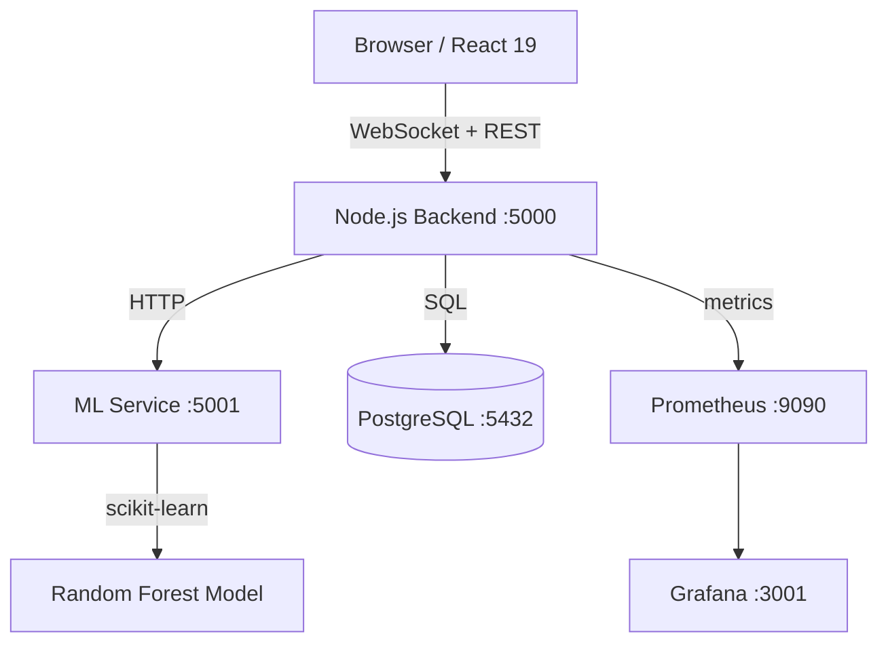

# ◈ ChronoLog

> Real-time log intelligence with causal chain detection

[](https://github.com/azzs11/chronolog/actions/workflows/ci.yml)
[](LICENSE)
[](https://nodejs.org/)
[](https://python.org/)

**ChronoLog** is an open, self-hosted log monitoring system that links log events into
*causal chains*. It shows you what broke, what probably caused it, and how far the damage spread.

> **Status:** ChronoLog 2.0 is in progress. The current engine (ChronoLog-H) uses hand-tuned rules.
> It is now measured on real incidents, and the honest result is that it is not good yet.
> See [Benchmark](#benchmark) and [docs/ROADMAP.md](docs/ROADMAP.md).

## Benchmark

On all 359 real incidents in [RCAEval](https://github.com/phamquiluan/RCAEval) (RE2 and RE3, logs only), ChronoLog-H
names the true root-cause service in its top 3 for **26.5%** of cases (95% interval 22–31%). Random guessing gets 10.7%.
The simple baseline "first service to log an error" gets 28.1% (23–33%), so **ChronoLog-H is better than chance but
not distinguishable from that trivial baseline**. On the 131 held-out test cases the figures are 29.0% and 27.5%.
In 26 cases the faulty service writes no logs at all, so no log-based method can name it. Every method, interval,
system and fault type is in [bench/results/RESULTS-full.md](bench/results/RESULTS-full.md); a faster 40-case subset
is in [RESULTS.md](RESULTS.md). Both are reproduced by one command (`uv run bench all`, see [bench/](bench/)).
A first learned ranker, **RootRank** (LightGBM lambdarank over log features such as novel templates, error
timing and which services other services name), reaches **52.6%** AC@3 (95% interval 48–57%, 5 seeds) on all 359
cases when whole root services are held out of training, against 26.5% for ChronoLog-H. Splitting by case id
instead would give a higher number, because RCAEval has several instances of the same fault on the same service
and the model can recognise the service; the strict figure is the one to quote. Leaving one whole system out gives
53.5%. Details, other splits and the most used features are in
[bench/results/RESULTS-rootrank.md](bench/results/RESULTS-rootrank.md); run it with `uv run bench rootrank`.
The split matters: on the 90 Train Ticket code-fault cases RootRank is right in its top 3 every time (probably
because changed code logs messages never seen before), while on the 269 resource-fault cases (cpu, memory, disk,
delay, packet loss, socket) it gets **36.8%**, against 20.8% for "first service to log an error". The ablation shows one
signal, templates a service never logged before, carries almost all of the gain
([bench/results/RESULTS-ablation.md](bench/results/RESULTS-ablation.md), `uv run bench ablate`).
RootRank holds up on messy logs: with a model trained on clean logs and held-out cases degraded, 40% of log lines
dropped at random costs 1.3 points of AC@3 (51.3%), and ±2 s of clock skew per service costs 0.4
([bench/results/RESULTS-robustness.md](bench/results/RESULTS-robustness.md), `uv run bench robustness`).
Adding ChronoLog-H's own score as a feature makes RootRank worse (49.1%), so the hand-written rules are not used in it.
RootRank is not yet part of the running app.
Anomaly detection was scored too, on the first 2 million lines of Loghub HDFS and BGL
([bench/results/RESULTS-anomaly.md](bench/results/RESULTS-anomaly.md)). The current rules are weak there:
F1 is 1.5% on HDFS (block-level anomalies hide in event sequences, not severity) and 19.1% on BGL, where a
plain "flag error and critical lines" rule gets 67.9%. Run it with `uv run bench anomaly`.
The roadmap's next phases aim to beat these baselines, and the results will be published either way.

---

## How ChronoLog Differs

Automated root-cause analysis is not new. Commercial tools already do it well:
[Datadog Watchdog RCA](https://docs.datadoghq.com/watchdog/)
has been generally available since 2021, and Datadog's Bits AI SRE investigates alerts on its own.
ChronoLog aims to be different in four ways:

- **Open:** the engine, the rules and the data pipeline are all MIT-licensed and readable.
- **Explainable:** every causal link comes with the signals that created it (timing, severity, shared entities, service dependency).
- **Benchmarked (planned):** root-cause accuracy will be measured on public RCA benchmarks, and every number will link to the script that produced it.
- **Self-hosted:** one `docker compose up` on your own machine. No log data leaves it.

---

## Causal Intelligence

When your database goes down, ChronoLog shows you:

```
[CRITICAL] db: connection pool exhausted          ← ROOT CAUSE (blast radius: 14.2)
  └─[ERROR]  api: failed to fetch user data        ← depth 1
      └─[ERROR]  auth: session validation failed   ← depth 2
          └─[WARNING] api: returning 503           ← depth 3

Fix the root node. The downstream symptoms resolve automatically.
```

The causal engine works by correlating log timestamps, source services, and error signatures
within a sliding 30-second window. When a chain is detected, a `causal:chain-detected`
WebSocket event fires within 500ms and the D3 graph updates live.

---

## Architecture



| Layer | Technology |
|-------|-----------|
| Frontend | React 19, Vite, TypeScript, Tailwind CSS 3, D3.js, Socket.io-client |
| Backend | Node.js 22, TypeScript, Express, Socket.io, Winston |
| ML Service | Python 3.12, FastAPI, scikit-learn |
| Database | PostgreSQL 15 |
| Monitoring | Prometheus, Grafana |
| Infrastructure | Docker, nginx |

---

## ML Model

- **Algorithm**: Random Forest with TF-IDF (n-grams 1–3)
- **Task**: predicts a log's severity level from its message text
- **Training data**: synthetic logs from `apps/ml/src/data_generator.py`
- **Accuracy**: not reported yet. Scores on synthetic data say little about real logs, so
  no number is shown until the model is evaluated on real, labelled datasets.

Real logs usually carry their own level, so the roadmap repurposes this model for logs that
arrive without one.

---

## Quick Start

```bash
git clone https://github.com/azzs11/chronolog.git
cd chronolog
cp .env.example .env   # then set your own passwords, including GRAFANA_PASSWORD
docker compose up -d                        # app only: 4 containers
docker compose --profile monitoring up -d   # also Prometheus + Grafana
docker compose down                         # stop and remove everything
```

Each container has a memory cap (about 1.1 GB for the app, 1.6 GB with monitoring).

Open [http://localhost:3000](http://localhost:3000)

| Service | URL | Credentials |
|---------|-----|-------------|
| App | http://localhost:3000 | — |
| Backend API | http://localhost:5050 (`BACKEND_PORT`) | — |
| ML Service | http://localhost:5001 | — |
| Grafana (monitoring profile) | http://localhost:3001 | `admin` / `GRAFANA_PASSWORD` from `.env` |
| Prometheus (monitoring profile) | http://localhost:9090 | — |

> **First run**: the `ml-service` container trains the model during build (`~30s`).
> Subsequent starts use the cached image and are instant.

---

## Development (without Docker)

### Backend

```bash
npm install                          # at the repo root (npm workspaces)
npm run build                        # builds packages/engine
npm run dev -w chronolog-backend     # tsx watch, port 5000
```

### ML Service

```bash
cd apps/ml                                  # needs uv: https://docs.astral.sh/uv/
uv sync                                     # Python 3.12 + dependencies
uv run python -m chronolog_ml.train_model   # one-time
uv run uvicorn chronolog_ml.app:app --port 5001
uv run pytest && uv run ruff check .        # tests and lint
```

### Frontend

```bash
npm run dev -w chronolog-web     # Vite dev server, port 3000
```

Set `VITE_API_URL=http://localhost:5000` and `VITE_WS_URL=http://localhost:5000` in
`apps/web/.env` if your backend is not on port 5000.

---

## API Reference

All endpoints return `{ status, data, meta }`.

### Backend (`:5000`)

| Method | Path | Description |
|--------|------|-------------|
| `GET` | `/health` | Health check |
| `GET` | `/api/logs` | Paginated log list (`?limit=50&offset=0&severity=error`) |
| `POST` | `/api/logs` | Ingest a log entry |
| `GET` | `/api/logs/stats` | Severity counts + throughput |
| `GET` | `/api/anomalies` | Detected anomalies |
| `GET` | `/api/metrics` | Prometheus metrics |

### ML Service (`:5001`)

| Method | Path | Description |
|--------|------|-------------|
| `GET` | `/health` | Health + model metadata |
| `POST` | `/api/classify` | Classify a single log message |
| `POST` | `/api/classify/batch` | Classify up to 100 messages |

### WebSocket Events

| Event | Direction | Description |
|-------|-----------|-------------|
| `log:new` | server → client | New log entry ingested |
| `log:stats` | server → client | Updated severity counts |
| `causal:chain-detected` | server → client | New causal chain identified |
| `anomaly:detected` | server → client | Temporal anomaly fingerprint |

---

## Environment Variables

Copy `.env.example` to `.env` and change values for production.

| Variable | Default | Description |
|----------|---------|-------------|
| `POSTGRES_PASSWORD` | `debug_secret` | PostgreSQL password |
| `ADMIN_API_KEY` | `dev_key_change_in_prod` | Admin endpoint key |
| `GRAFANA_PASSWORD` | none (required) | Grafana admin password. Compose refuses to start without it |

---

## Screenshots

<div align="center">


**Main Dashboard — real-time log stream with causal chain overlay**

<br/>


**ML Analytics — confidence scores and severity distribution**

<br/>


**Grafana — throughput, WebSocket connections, ML latency**

</div>

---

## Contributing

See [CONTRIBUTING.md](CONTRIBUTING.md) and the [roadmap](docs/ROADMAP.md).

---

## License

[MIT](LICENSE) — free for personal and commercial use.

---

## Author

**Akchhya Singh** — [GitHub](https://github.com/azzs11) · [LinkedIn](https://linkedin.com/in/akchhya-singh11) · akchhya.dev@gmail.com
