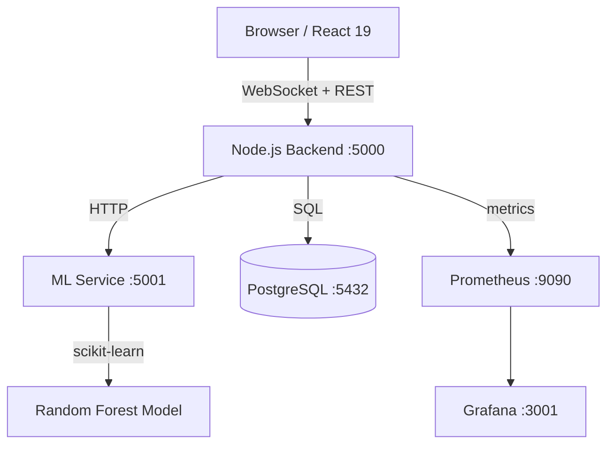

# ◈ ChronoLog

> Real-time log intelligence with causal chain detection

[](https://github.com/azzs11/chronolog/actions/workflows/ci.yml)
[](LICENSE)
[](https://nodejs.org/)
[](https://python.org/)

**ChronoLog** is an open, self-hosted log monitoring system that links log events into
*causal chains*. It shows you what broke, what probably caused it, and how far the damage spread.

> **Status:** ChronoLog 2.0 is in progress. It now ships a learned root-cause ranker, **RootRank**, that is measured
> on real incidents and clearly beats the older hand-tuned rules, though it is far from perfect. See
> [Benchmark](#benchmark) and [docs/ROADMAP.md](docs/ROADMAP.md).

## Try it

- **The Arcade** (no install): ChronoLog's training mode. Training Town teaches you to read the app in three short
  cases; then a Daily Case, 30 real incidents from RCAEval (Real Systems), a sandbox where you break things yourself,
  and, in the self-hosted app, drills built from your own reviewed incidents. Every case ends with what gave it away
  and field notes on what to check in production. It runs entirely in your browser: `npm run build:demo -w
  chronolog-web`, and [docs/DEPLOY.md](docs/DEPLOY.md) explains hosting it. Locally, open the **Arcade** view; the
  Real Systems cases are written by `uv run bench export-puzzles`.
- **Your own logs** from the command line, one file per service:

  ```bash
  npm ci && npm run build
  node apps/cli/dist/cli.js analyze logs/api.log logs/db.log logs/cache.log --start 2026-11-19T10:02:00Z
  ```

  Plain-text lines that begin with a time, and JSON lines, are understood. If you leave out `--start`, ChronoLog
  estimates when the incident began (less accurate). Nothing leaves your machine.
- **The running app**: `docker compose up -d`, then open the **Incidents** inbox. It lists bursts of error lines, ranks the
  likely root causes with the evidence, and lets you confirm or correct the answer; your answers are stored with the
  ranking they were given for, to improve ChronoLog later. (A burst is something worth a look, not proof of an incident.)
  The **Root Cause** view and `POST /api/rca/rank` (below) rank any window you choose.

---

## Benchmark

Every number below comes from a script in this repo. The data is 359 real incidents from
[RCAEval](https://github.com/phamquiluan/RCAEval) (RE2 and RE3, logs only). The question is: does the method name
the true root-cause service in its top 3 (AC@3)? Intervals are 95% bootstrap intervals that resample whole
(system, root service) groups, because several incidents are repeats of the same fault on the same service.

| Method | AC@3 | 95% interval |
|---|---|---|
| Random guessing | 10.7% | ± 4.8 over 5 seeds |
| First service to log an error | 28.1% | 16–41% |
| ChronoLog-H (the hand-written rules the app runs today) | 26.5% | 14–40% |
| **RootRank** (learned ranker; whole root services held out of training) | **52.6%** | 43–61% |

On the same cases RootRank beats first-error by 24.5 points (interval +10.6 to +36.6) and ChronoLog-H by 26.2
points (+10.5 to +40.3). ChronoLog-H is better than chance but not distinguishable from the trivial baseline.

What to know before quoting these:

- **Easy and hard faults differ a lot.** On the 90 Train Ticket code-fault cases RootRank is right every time, and
  the reason is measured: those faults were injected by restarting the service, so in 81 of 90 cases the faulty
  service logs shutdown or startup lines it never logged before. That is a real production signal too, but an
  artifact of this benchmark's fault injection. On the 269 resource-fault cases (cpu, memory, disk, delay, packet
  loss, socket) RootRank gets **36.8%**, against 20.8% for first-error.
- **One signal does most of the work:** templates a service never logged before. Two further feature families I
  tried did not help, and ChronoLog-H's own score made RootRank worse.
- **It holds up on messy logs:** dropping 40% of lines costs 1.3 points; ±2 s of clock skew costs 0.4; a 60 s outage of
  all logs or a 120 s outage of one service, placed at random, costs under half a point (a gap that hides the faulty
  service exactly when it breaks would cost more).
- **Leaving one whole system out** gives 53.5%. Splitting by case id would give a higher number, because the model
  could recognise repeated services, so the strict figure is the one to quote.
- In 26 of the 359 cases the faulty service writes no logs, so no log-based method can name it.
- **The service graph can be learned from logs, unevenly.** Compared with the real call graphs of Online Boutique and
  Sock Shop (Train Ticket is not scored), "A's logs name B" edges have 93% precision on Sock Shop but 2% on Online
  Boutique, whose logs never name other services; volume-correlation edges reach F1 51% there. Neither wins everywhere
  ([RESULTS-graph.md](bench/results/RESULTS-graph.md), `uv run bench graph`; served by `GET /api/rca/graph`).
- **The creatures' faces are as good as RootRank at top 3, not at top 1.** The app draws each service with a face
  from its recent logs (`mood.ts`, no training). Ranking services by when they first look unwell after the fault
  gives AC@3 52.9% (41–64%), statistically tied with RootRank on the same cases (−0.3 points, −6.7 to +6.3), but
  AC@1 26.2% against RootRank's 37.2%. The broken service looks unwell within 5 minutes in 48% of incidents (median
  30 s), and 4% of services look unwell before anything broke. The "new phrase" face reuses RootRank's best signal,
  which was found on these incidents ([RESULTS-moods.md](bench/results/RESULTS-moods.md), `uv run bench moods`).
- **Anomaly detection is weak.** On Loghub HDFS and BGL the current rules score F1 1.5% and 19.1%, and a plain
  "flag error lines" rule gets 67.9% on BGL.
- **RootRank is in the app** (the Root Cause view, and `POST /api/rca/rank`, below). Given the true incident start it
  scores 53.2% AC@3 on randomly cropped windows. When the start is estimated from the logs instead, as the app does if
  you do not give one, it scores **45.0%** (36–53%); the old "first error line" rule for finding the start scored 31.6%
  ([RESULTS-autostart.md](bench/results/RESULTS-autostart.md), `uv run bench autostart`). The estimate finds *when* the
  logs changed most; it cannot tell a calm window from an incident, so you tell it something went wrong.

Details: [RESULTS-rootrank.md](bench/results/RESULTS-rootrank.md) (`uv run bench rootrank`),
[RESULTS-ablation.md](bench/results/RESULTS-ablation.md) (`uv run bench ablate`),
[RESULTS-robustness.md](bench/results/RESULTS-robustness.md) (`uv run bench robustness`),
[RESULTS-anomaly.md](bench/results/RESULTS-anomaly.md) (`uv run bench anomaly`),
[RESULTS-moods.md](bench/results/RESULTS-moods.md) (`uv run bench moods`),
[RESULTS-full.md](bench/results/RESULTS-full.md) and [RESULTS.md](RESULTS.md) (`uv run bench all`).

---

## How ChronoLog Differs

Automated root-cause analysis is not new. Commercial tools already do it well:
[Datadog Watchdog RCA](https://docs.datadoghq.com/watchdog/)
has been generally available since 2021, and Datadog's Bits AI SRE investigates alerts on its own.
ChronoLog aims to be different in four ways:

- **Open:** the engine, the rules and the data pipeline are all MIT-licensed and readable.
- **Explainable:** every causal link comes with the signals that created it (timing, severity, shared entities, service dependency).
- **Benchmarked (planned):** root-cause accuracy will be measured on public RCA benchmarks, and every number will link to the script that produced it.
- **Self-hosted:** one `docker compose up` on your own machine. No log data leaves it.

---

## Causal Intelligence

When your database goes down, ChronoLog shows you:

```
[CRITICAL] db: connection pool exhausted          ← ROOT CAUSE (blast radius: 14.2)
  └─[ERROR]  api: failed to fetch user data        ← depth 1
      └─[ERROR]  auth: session validation failed   ← depth 2
          └─[WARNING] api: returning 503           ← depth 3

Fix the root node. The downstream symptoms resolve automatically.
```

The causal engine works by correlating log timestamps, source services, and error signatures
within a sliding 30-second window. When a chain is detected, a `causal:chain-detected`
WebSocket event fires within 500ms and the D3 graph updates live.

---

## Architecture



| Layer | Technology |
|-------|-----------|
| Frontend | React 19, Vite, TypeScript, Tailwind CSS 3, D3.js, Socket.io-client |
| Backend | Node.js 22, TypeScript, Express, Socket.io, Winston |
| ML Service | Python 3.12, FastAPI, scikit-learn |
| Database | PostgreSQL 15 |
| Monitoring | Prometheus, Grafana |
| Infrastructure | Docker, nginx |

---

## ML Model

- **Algorithm**: Random Forest with TF-IDF (n-grams 1–3)
- **Task**: predicts a log's severity level from its message text
- **Training data**: synthetic logs from `apps/ml/src/data_generator.py`
- **Accuracy**: not reported yet. Scores on synthetic data say little about real logs, so
  no number is shown until the model is evaluated on real, labelled datasets.

Real logs usually carry their own level, so the roadmap repurposes this model for logs that
arrive without one.

---

## Quick Start

```bash
git clone https://github.com/azzs11/chronolog.git
cd chronolog
cp .env.example .env   # then set your own passwords, including GRAFANA_PASSWORD
docker compose up -d                        # app only: 4 containers
docker compose --profile monitoring up -d   # also Prometheus + Grafana
docker compose down                         # stop and remove everything
```

Each container has a memory cap (about 1.1 GB for the app, 1.6 GB with monitoring).

Open [http://localhost:3000](http://localhost:3000)

| Service | URL | Credentials |
|---------|-----|-------------|
| App | http://localhost:3000 | — |
| Backend API | http://localhost:5050 (`BACKEND_PORT`) | — |
| ML Service | http://localhost:5001 | — |
| Grafana (monitoring profile) | http://localhost:3001 | `admin` / `GRAFANA_PASSWORD` from `.env` |
| Prometheus (monitoring profile) | http://localhost:9090 | — |

> **First run**: the `ml-service` container trains the model during build (`~30s`).
> Subsequent starts use the cached image and are instant.

---

## Development (without Docker)

### Backend

```bash
npm install                          # at the repo root (npm workspaces)
npm run build                        # builds packages/engine
npm run dev -w chronolog-backend     # tsx watch, port 5000
```

### ML Service

```bash
cd apps/ml                                  # needs uv: https://docs.astral.sh/uv/
uv sync                                     # Python 3.12 + dependencies
uv run python -m chronolog_ml.train_model   # one-time
uv run uvicorn chronolog_ml.app:app --port 5001
uv run pytest && uv run ruff check .        # tests and lint
```

### Frontend

```bash
npm run dev -w chronolog-web     # Vite dev server, port 3000
```

Set `VITE_API_URL=http://localhost:5000` and `VITE_WS_URL=http://localhost:5000` in
`apps/web/.env` if your backend is not on port 5000.

---

## API Reference

All endpoints return `{ status, data, meta }`.

### Backend (`:5000`)

| Method | Path | Description |
|--------|------|-------------|
| `GET` | `/health` | Health check |
| `GET` | `/api/logs` | Paginated log list (`?limit=50&offset=0&severity=error`) |
| `POST` | `/api/logs` | Ingest a log entry |
| `GET` | `/api/logs/stats` | Severity counts + throughput |
| `GET` | `/api/anomalies` | Detected anomalies |
| `POST` | `/api/rca/rank` | Rank the services most likely to have caused an incident (see below) |
| `GET` | `/api/incidents` | Bursts of error lines in the stored logs, biggest impact first, with review status |
| `GET` | `/api/incidents/:id` | One incident with its ranking, evidence, per-service timeline and learned service graph |
| `POST` | `/api/incidents/:id/feedback` | "Was this the root cause?" `{ verdict: confirm \| reject, correct_service?, note? }` |
| `GET` | `/api/incidents/feedback/summary` | How often the first choice was right on incidents you reviewed |
| `GET` | `/api/moods` | Each service's mood right now (fine, new phrase, stressed, sick, gone quiet, restarted): the last 2 minutes against the 15 before, with a reason and the log ids behind it. Moods are symptoms, not causes |
| `GET` | `/api/metrics` | Prometheus metrics |

#### `POST /api/rca/rank`

Ranks which service most likely broke first, with evidence. Body, all optional:

- `incident_start`: Unix seconds or an ISO time. If you leave it out, ChronoLog estimates it from the logs.
- `lookback_minutes` (1 to 120, default 15): which stored logs to use, when you do not send `logs`.
- `logs`: up to 20,000 lines `{ timestamp, source, message, severity?, id? }` to rank instead of the stored logs.

```bash
curl -X POST localhost:5050/api/rca/rank -H 'Content-Type: application/json' -d '{"lookback_minutes": 15}'
```

Each candidate has a `rank`, a relative `weight` (not a probability) and `evidence` built from real log lines: when it
first logged an error, the messages it never logged before (with a log id), and how often other services mention it.
It answers `422` if the logs span under 4 minutes (too short to estimate a start) or there are no logs. The accuracy
you should expect is in the [Benchmark](#benchmark) section.

### ML Service (`:5001`)

| Method | Path | Description |
|--------|------|-------------|
| `GET` | `/health` | Health + model metadata |
| `POST` | `/api/classify` | Classify a single log message |
| `POST` | `/api/classify/batch` | Classify up to 100 messages |

### WebSocket Events

| Event | Direction | Description |
|-------|-----------|-------------|
| `log:new` | server → client | New log entry ingested |
| `log:stats` | server → client | Updated severity counts |
| `causal:chain-detected` | server → client | New causal chain identified |
| `anomaly:detected` | server → client | Temporal anomaly fingerprint |

---

## Environment Variables

Copy `.env.example` to `.env` and change values for production.

| Variable | Default | Description |
|----------|---------|-------------|
| `POSTGRES_PASSWORD` | `debug_secret` | PostgreSQL password |
| `ADMIN_API_KEY` | `dev_key_change_in_prod` | Admin endpoint key |
| `GRAFANA_PASSWORD` | none (required) | Grafana admin password. Compose refuses to start without it |

---

## Screenshots

<div align="center">


**Main Dashboard — real-time log stream with causal chain overlay**

<br/>


**ML Analytics — confidence scores and severity distribution**

<br/>


**Grafana — throughput, WebSocket connections, ML latency**

</div>

---

## Contributing

See [CONTRIBUTING.md](CONTRIBUTING.md) and the [roadmap](docs/ROADMAP.md).

---

## License

[MIT](LICENSE) — free for personal and commercial use.

---

## Author

**Akchhya Singh** — [GitHub](https://github.com/azzs11) · [LinkedIn](https://linkedin.com/in/akchhya-singh11) · akchhya.dev@gmail.com
