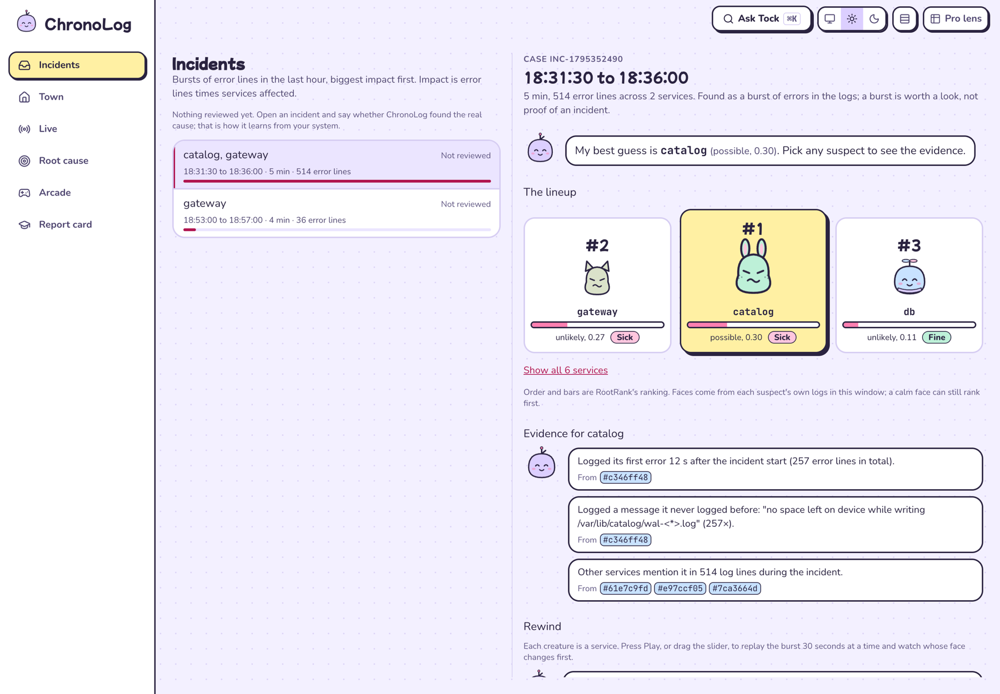
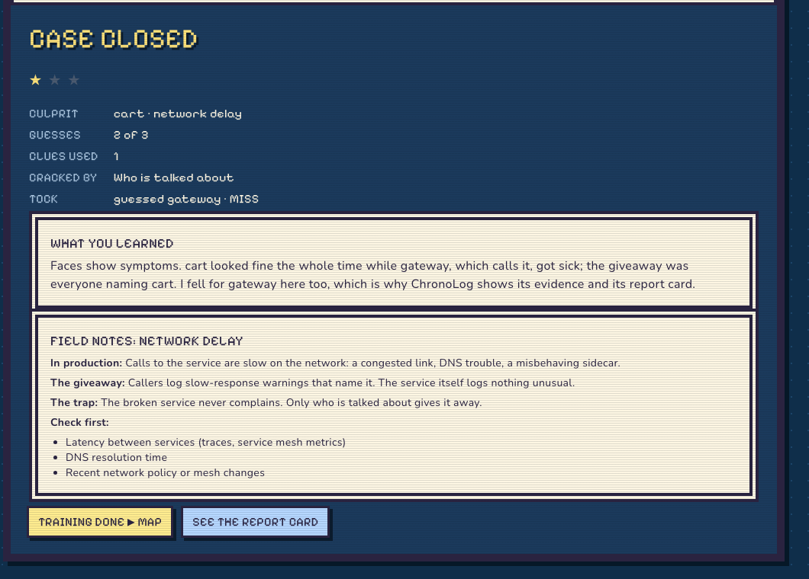
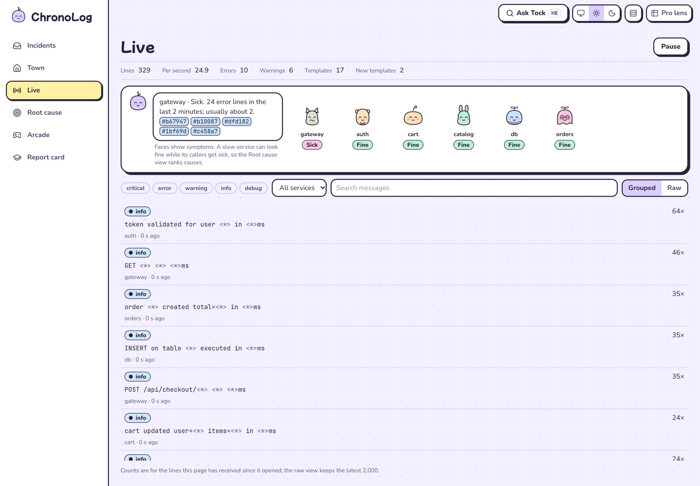
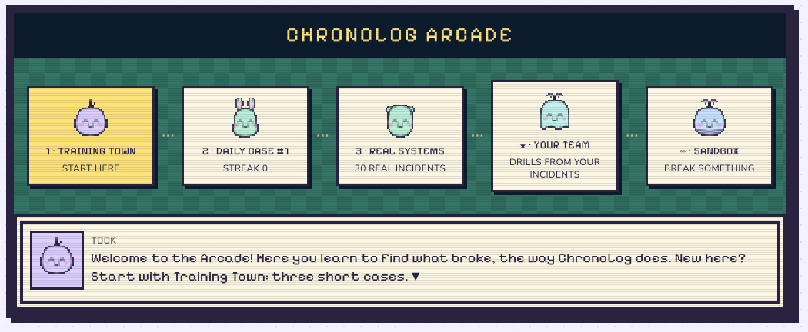
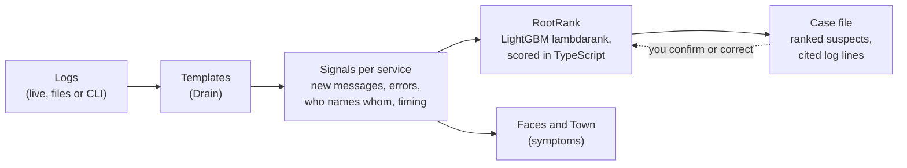

# ChronoLog

**An open root-cause engine for logs.** When something breaks, ChronoLog ranks which service broke first, shows
the exact log lines behind every claim, and publishes how often it is right.

[](https://github.com/azzs11/chronolog/actions/workflows/ci.yml)
[](LICENSE)
[](https://nodejs.org/)
[](https://python.org/)

**[▶ Try the live demo](https://chronolog.akchhya.xyz/)**: the whole app (incidents, case files, town, live stream,
root cause, Arcade, report card) runs in your browser on a simulated six-service shop. No backend, nothing uploaded;
you can also drop your own log files on the Root cause page.

<p align="center">
  
  <br/><sub>A case file from the live demo: a disk fault in <code>catalog</code>, with every claim citing the log lines it came from.</sub>
</p>

Every service in your system is drawn as a small creature whose face comes from its own logs. When an incident
happens, ChronoLog opens a **case file**: a lineup of suspects ranked by **RootRank** (a learned ranker), the
evidence for each one with the log ids it came from, a replay of how the trouble spread, and a button to confirm or
correct the answer so the ranker can learn from your system.

> **Status:** ChronoLog 2.0 is close to done: the engine, benchmark, redesigned app and Arcade are built, and the
> [demo is live](https://chronolog.akchhya.xyz/); a user study and the technical report are next ([roadmap](docs/ROADMAP.md)). Every number on this page links
> to the script that produced it.

---

## Results

On **359 real incidents** from [RCAEval](https://github.com/phamquiluan/RCAEval) (RE2 and RE3, logs only), using
services the model never saw in training. AC@k is how often the real culprit is in the top k suggestions.

| Method | AC@1 | AC@3 | 95% interval (AC@3) |
|---|---|---|---|
| Random guessing | 2.4% | 10.7% | ± 4.8 over 5 seeds |
| First service to log an error | 7.2% | 28.1% | 16–41% |
| ChronoLog-H (the old hand-written rules) | 7.8% | 26.5% | 14–40% |
| Faces: first service to look unwell (no training) | 26.2% | 52.9% | 41–64% |
| **RootRank** (learned ranker) | **37.2%** | **52.6%** | 43–61% |

RootRank beats the first-error rule by 24.5 points of AC@3 on the same incidents (+10.6 to +36.6). The creatures'
faces tie RootRank at top 3, but RootRank is better at naming the single culprit. On the hardest group, resource
faults (CPU, memory, disk, network, sockets), RootRank gets **36.8%**. The full story, failures included, is in
[Benchmark details](#benchmark-details).

<sub>Sources: [RESULTS-rootrank.md](bench/results/RESULTS-rootrank.md) (`uv run bench rootrank`),
[RESULTS-moods.md](bench/results/RESULTS-moods.md) (`uv run bench moods`),
[RESULTS-ablation.md](bench/results/RESULTS-ablation.md) (`uv run bench ablate`).</sub>

---

## A tour

Every screenshot below is from the [live demo](https://chronolog.akchhya.xyz/), so the data is simulated. The
self-hosted app shows the same views over your own logs.

<table>
  <tr>
    <td width="50%"></td>
    <td width="50%"></td>
  </tr>
  <tr>
    <td><b>Town.</b> Every service and its mood right now (fine, new phrase, stressed, sick, gone quiet, restarted),
    each with a written reason and the log ids behind it. Roads are learned from which services name each other.</td>
    <td><b>Arcade.</b> ChronoLog's training mode. Three short cases teach you to read the app; then a Daily Case,
    30 real incidents, a sandbox, and drills built from your own reviewed incidents.</td>
  </tr>
  <tr>
    <td></td>
    <td></td>
  </tr>
  <tr>
    <td>Every case ends with what gave it away, how Tock (the ranker) did, and <b>field notes</b>: what this fault
    looks like in production and what to check first.</td>
    <td><b>Report card.</b> The benchmark as charts inside the app, weak grades included. Generated from
    <code>bench/results</code>, never typed by hand.</td>
  </tr>
  <tr>
    <td></td>
    <td></td>
  </tr>
  <tr>
    <td><b>Pro lens</b> (Shift+P). The same data as dense, keyboard-friendly tables, for when you want facts, not
    creatures.</td>
    <td><b>Live.</b> Incoming logs grouped by message template, with messages nobody has seen before flagged.</td>
  </tr>
  <tr>
    <td></td>
    <td align="center"></td>
  </tr>
  <tr>
    <td><b>Root cause.</b> Rank any window on demand, or inject a test incident with a known cause and see where
    ChronoLog puts it. Misses are shown the same way as hits.</td>
    <td><b>On a phone.</b> Every view works at phone width, with the lineup as stacked cards.</td>
  </tr>
</table>

<p align="center"></p>

---

## How it works



1. **Templates.** Each log line is turned into a template with [Drain](https://github.com/logpai/Drain3)
   (`user 42 logged in` and `user 7 logged in` become one template). The TypeScript port is checked against the
   Python original on real incidents.
2. **Signals.** For each service: messages it never logged before, error counts and spikes, how often other services
   name it, and when each of those started. The strongest signal by far is *new messages*.
3. **RootRank.** A LightGBM learning-to-rank model, trained offline on the benchmark and exported as JSON trees that
   the TypeScript engine scores. The same engine runs in the server, the browser and the CLI.
4. **Case file.** The ranking, with every evidence sentence built from engine fields and citing log ids. Your
   confirm or correct is stored with the features the model saw, so it can be retrained on your system later.

The old engine, ChronoLog-H (weighted rules over timing, severity and shared entities), still runs as the
named baseline.

| Part | Technology |
|---|---|
| Engine (`packages/engine`) | TypeScript, pure (no I/O), shared by server, browser and CLI |
| Web (`apps/web`) | React 19, Vite, TypeScript, Tailwind 4 |
| API (`apps/api`) | Node.js 22, Express, Socket.io, PostgreSQL 15 |
| CLI (`apps/cli`) | `chronolog analyze` for log files |
| Benchmark (`bench/`) | Python 3.12, uv, LightGBM, pandas |
| ML service (`apps/ml`) | FastAPI, scikit-learn (severity classifier; being repurposed) |

---

## How ChronoLog differs

Automated root-cause analysis is not new: [Datadog Watchdog RCA](https://docs.datadoghq.com/watchdog/) has been
generally available since 2021, and Datadog's Bits AI SRE investigates alerts on its own. ChronoLog aims to be
different in four ways:

- **Open:** the engine, the model, the benchmark and the data pipeline are MIT-licensed and readable.
- **Explainable:** every claim cites the log lines it came from; faces and moods come with a written reason.
- **Benchmarked:** accuracy is measured on public incidents, with the failures published next to the wins.
- **Self-hosted:** one `docker compose up` on your own machine. No log data leaves it.

---

## Quick start

```bash
git clone https://github.com/azzs11/chronolog.git
cd chronolog
cp .env.example .env          # set your own passwords, including GRAFANA_PASSWORD
docker compose up -d          # the app: 4 containers, about 1.1 GB of memory at most
```

Open the app on **port 3000**. To see a case straight away, inject a simulated incident with a known cause
(set `API` to the API's address; it listens on port 5050 by default):

```bash
curl -X POST "$API/api/rca/incident" -H 'Content-Type: application/json' \
  -H 'X-API-Key: dev_key_change_in_prod' -d '{"service":"catalog","fault":"disk"}'
```

Then open **Incidents**. Send your own logs with `POST /api/logs`, or start sample traffic with
`POST /api/logs/generator/start` (admin key).

**Your own log files**, from the command line (one file per service; plain text with a time at the start of each
line, or JSON lines):

```bash
npm ci && npm run build
node apps/cli/dist/cli.js analyze logs/api.log logs/db.log logs/cache.log --start 2026-11-19T10:02:00Z
```

Leave out `--start` and ChronoLog estimates when the incident began (less accurate). In the app, the same works in
the browser under **Root cause → Analyse log files**; nothing is uploaded.

**The Arcade without a backend** (a static site; see [docs/DEPLOY.md](docs/DEPLOY.md) to host it):

```bash
npm run build:demo -w chronolog-web     # writes apps/web/dist-demo
```

| Service | Host port |
|---|---|
| App | 3000 |
| API | 5050 (`BACKEND_PORT`) |
| ML service | 5001 |
| Grafana, Prometheus (`docker compose --profile monitoring up -d`) | 3001, 9090 |

---

## Reproduce the numbers

```bash
cd bench                                # needs uv: https://docs.astral.sh/uv/
uv run bench download --subset full     # RCAEval logs (about 400 MB on disk)
uv run bench all --subset full          # baselines and ChronoLog-H, about 45 min  -> RESULTS-full.md
uv run bench templates --subset full    # Drain templates, cached               (about 8 min)
uv run bench rootrank                   # RootRank, 5 seeds                      -> RESULTS-rootrank.md
uv run bench ablate                     # what each signal is worth             -> RESULTS-ablation.md
uv run bench moods                      # the faces as a ranking                -> RESULTS-moods.md
uv run bench robustness                 # dropped lines, gaps, clock skew       -> RESULTS-robustness.md
uv run bench export-facts               # regenerates the numbers the app shows
```

Splits are fixed by case id before any tuning, intervals resample whole (system, root service) groups, and the runs
are byte-for-byte repeatable. A test fails if the numbers shown in the app drift from `bench/results`.

---

## Benchmark details

What to know before quoting the numbers:

- **Easy and hard faults differ a lot.** On the 90 Train Ticket code-fault cases RootRank is right every time. The
  reason is measured: those faults were injected by restarting the service, so in 81 of 90 cases the faulty service
  logs shutdown or startup lines it never logged before. On the 269 resource-fault cases RootRank gets **36.8%**,
  against 20.8% for first-error ([RESULTS-ablation.md](bench/results/RESULTS-ablation.md)).
- **One signal does most of the work:** messages a service never logged before. Two further feature families did
  not help, and ChronoLog-H's own score made RootRank worse.
- **It holds up on messy logs:** dropping 40% of lines costs 1.3 points of AC@3; ±2 s of clock skew costs 0.4
  ([RESULTS-robustness.md](bench/results/RESULTS-robustness.md)).
- **The start time matters.** Given the true incident start, RootRank scores 53.2% AC@3 on randomly cropped
  windows; estimated from the logs, as the app does when you do not give one, **45.0%** (36–53%)
  ([RESULTS-autostart.md](bench/results/RESULTS-autostart.md)).
- **The faces** (no training) are statistically tied with RootRank at AC@3 (−0.3 points, −6.7 to +6.3) but behind
  at AC@1 (26.2% vs 37.2%). The broken service looks unwell within 5 minutes in 48% of incidents; 4% of services look
  unwell before anything broke. The "new phrase" face reuses RootRank's best signal, found on these incidents
  ([RESULTS-moods.md](bench/results/RESULTS-moods.md)).
- **The service graph can be learned from logs, unevenly:** "A's logs name B" edges have 93% precision on Sock Shop
  but 2% on Online Boutique, whose logs never name other services
  ([RESULTS-graph.md](bench/results/RESULTS-graph.md)).
- **Anomaly detection is weak.** On Loghub HDFS and BGL the current detector scores F1 1.5% and 19.1%, and a plain
  "flag error lines" rule gets 67.9% on BGL ([RESULTS-anomaly.md](bench/results/RESULTS-anomaly.md)). A new detector
  is the next phase.
- In 26 of the 359 cases the faulty service writes no logs, so no log-based method can name it.

---

## Limitations

- **Logs only.** No metrics or traces, so faults that barely touch the logs (CPU, slow networks) are the hardest.
- **Moods describe symptoms.** A slow service can look fine while its callers look sick; the case file ranks causes.
- **The Incidents inbox lists bursts of errors.** Faults that only produce warnings (memory pressure, a slow
  network) show in Town and Root cause, not as an inbox entry.
- **Confidence words are not calibrated yet:** "likely, 0.71" is a relative weight, not a probability.
- **Simulated cases are easier than real ones.** The Arcade's Training, Daily and Sandbox cases come from a small
  simulator; the Real Systems cases are real.
- **Single instance.** Fine for a team's logs, not built for a large fleet.

---

## API

All endpoints return `{ status, data }`. In Docker the API is on port 5050; `npm run dev` uses 5000.

| Method | Path | Description |
|---|---|---|
| `GET` | `/health` | Health check |
| `GET` | `/api/logs` | Recent logs (`?limit=50&severity=error`) |
| `POST` | `/api/logs` | Ingest a log line |
| `GET` | `/api/logs/stats` | Severity counts and throughput |
| `POST` | `/api/logs/generator/start` | Start sample traffic (admin key) |
| `GET` | `/api/incidents` | Bursts of error lines, biggest impact first, with review status |
| `GET` | `/api/incidents/:id` | One incident: ranking, evidence, per-service timeline, learned service graph |
| `POST` | `/api/incidents/:id/feedback` | "Was this the root cause?" `{ verdict: confirm \| reject, correct_service?, note? }` |
| `GET` | `/api/incidents/feedback/summary` | How often the first choice was right on the incidents you reviewed |
| `POST` | `/api/rca/rank` | Rank any window, or logs you send (see below) |
| `GET` | `/api/rca/graph` | The service graph learned from recent logs |
| `POST` | `/api/rca/incident` | Inject a simulated incident with a known cause (admin key) |
| `GET` | `/api/moods` | Each service's mood right now, with a reason and the log ids behind it |
| `GET` | `/api/causal/chains` | ChronoLog-H's causal chains (the old engine) |
| `GET` | `/api/anomalies` | Detected anomalies |
| `GET` | `/metrics` | Prometheus metrics |

`POST /api/rca/rank` takes, all optional: `incident_start` (Unix seconds or ISO time; estimated if left out),
`lookback_minutes` (1 to 120, default 15), or `logs` (up to 20,000 lines `{ timestamp, source, message, severity?, id? }`).
It answers `422` if the logs span under 4 minutes or there are none.

```bash
curl -X POST "$API/api/rca/rank" -H 'Content-Type: application/json' -d '{"lookback_minutes": 15}'
```

WebSocket events (server to client): `new-log`, `log-stats`, `causal-event`, `connection-success`.

---

## Development

```bash
npm ci                                   # at the repo root (npm workspaces)
npm run build                            # every package: engine, API, web, CLI, bench runner
npm run dev -w chronolog-backend         # API on :5000
npm run dev -w chronolog-web             # web on :3000 (set VITE_API_URL if the API is elsewhere)
npm test && npm run lint && npm run typecheck
(cd bench && uv run pytest && uv run ruff check .)
```

| Variable | Default | Description |
|---|---|---|
| `POSTGRES_PASSWORD` | `debug_secret` | PostgreSQL password |
| `ADMIN_API_KEY` | `dev_key_change_in_prod` | Key for admin endpoints |
| `GRAFANA_PASSWORD` | none (required) | Grafana admin password |
| `BACKEND_PORT` | `5050` | Host port for the API in Docker |

See [CONTRIBUTING.md](CONTRIBUTING.md).

---

## Roadmap

Done: honest housekeeping, the TypeScript monorepo, ChronoBench, RootRank, the redesign and the Arcade. Next: a
public demo, a new anomaly detector, evidence-locked incident stories (optional AI write-ups where every sentence
cites log ids, plus an MCP server for AI agents), a user study of the old and new UI, and a technical report.
Details in [docs/ROADMAP.md](docs/ROADMAP.md).

## Citation

```bibtex
@software{singh_chronolog_2026,
  author = {Singh, Akchhya},
  title  = {ChronoLog: an open, benchmarked root-cause engine for logs},
  year   = {2026},
  url    = {https://github.com/azzs11/chronolog}
}
```

ChronoLog's benchmark uses [RCAEval](https://github.com/phamquiluan/RCAEval) (Pham et al., WWW 2025) and
[Loghub](https://github.com/logpai/loghub); please cite them too.

## License

[MIT](LICENSE).

## Author

**Akchhya Singh** — [GitHub](https://github.com/azzs11) · [LinkedIn](https://linkedin.com/in/akchhya-singh11) · akchhya.dev@gmail.com
